[← overzicht](CHALLENGES.md)

---

# CSS challenge: Fonts en font-properties (en kleuren)
 

📗 ⸺
<a href="pres/FDND-CSSchallenge7-Fonts-intro.pdf" target="_blank" rel="noopener noreferrer">Fonts en font-properties intro</a> 
(pdf 3MB)  

---

## Oefening 1: 🌱 @font-face (opwarmen)

📊 ⸺ 🟦 🟥 Maak het blokje na  
🧑‍💻 ⸺ <a href="zips/challenge_typografie-oefening1.zip" target="_blank" rel="noopener noreferrer">Code voor jou</a> (zip)  
🧑‍💻 ⸺ <a href="https://codepen.io/editor/shooft/pen/019f1d52-e54b-7bfa-be80-647a337c11c4" target="_blank" rel="noopener noreferrer">Uitwerking</a> (CodePen) niet meteen spieken 🫣  

  
<h3>tips</h3>

  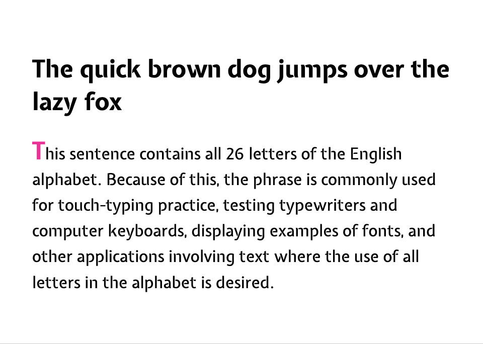  

  
Gebruikte lettertype(n)
  
 
  * expletus sans (400 en 700)
  * de font-bestanden staan in de map fonts

  
Gebruikte kleur(en)

 
  * #f09 (dieproze)  

  
Je het de volgende CSS nodig

   
  * @font-face (2x)  
  * main  
    * font-family  
  * main p  
    * line-height  
  * main p::first-letter  
    * font-size  
    * font-weight  
    * color  

---

## Oefening 2: 🖋️ meer text- en font-properties  

📊 ⸺ 🟦 🟥 Maak de twee blokjes na  
🧑‍💻 ⸺ <a href="zips/challenge_typografie-oefening2.zip" target="_blank" rel="noopener noreferrer">Code voor jou</a> (zip)  
🧑‍💻 ⸺ <a href="https://codepen.io/editor/shooft/pen/019f3740-f9a0-7308-8941-86d3924c9a37" target="_blank" rel="noopener noreferrer">Uitwerking</a> (CodePen) niet meteen spieken 🫣  

  
<h3>tips you go girl</h3>

  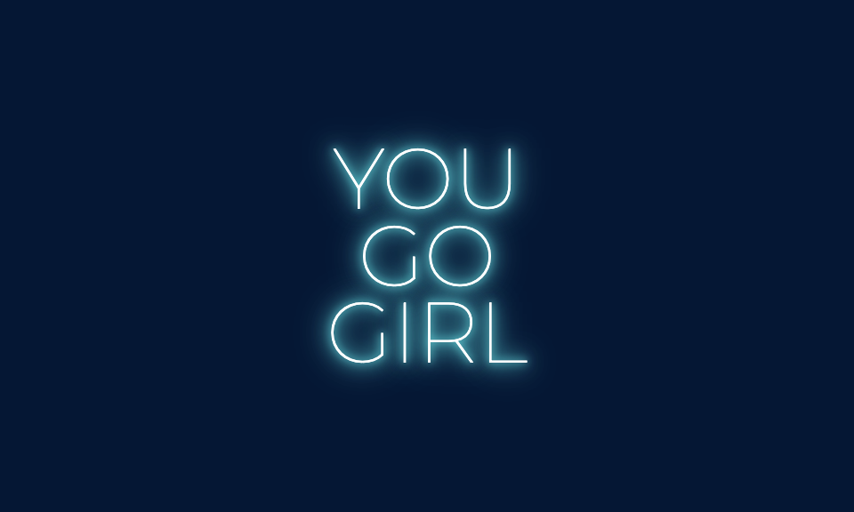  

  
Gebruikte lettertype(n)
  
 
  * montserrat (100)
  * de font-bestanden staan in de map fonts

  
Gebruikte kleur(en)

 
  * rgb(0 24 54) → donkerblauw
  * hsl(0 0% 100%) → wit
  * cyan 

  
Je het de volgende CSS nodig

   
  * @font-face
  * li:nth-of-type(1)
    * background-color
  * li:nth-of-type(1) h2
    * font-family
    * font-size
    * font-weight
    * color
    * line-height
    * text-transform
    * text-shadow 

  

  
<h3>tips good vibes only</h3>

  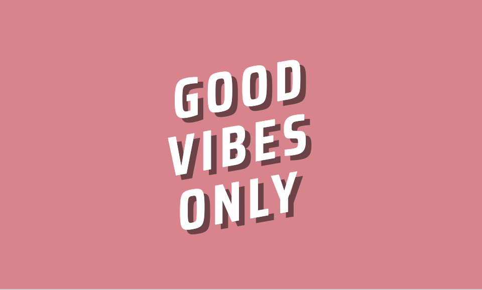  

  
Gebruikte lettertype(n)
  
 
  * saira condensed (700)
  * de font-bestanden staan in de map fonts

  
Gebruikte kleur(en)

 
  * rgb(230 127 138) → roze
  * white
  * rgb(0 0 0 / .5) → half-transparant zwart 

  
Je het de volgende CSS nodig

   
  * @font-face
  * li:nth-of-type(2)
    * background-color
  * li:nth-of-type(2) h2
    * font-family
    * font-size
    * line-height
    * letter-spacing
    * text-transform
    * text-align
    * text-shadow
    * color
    * transform → skewY

  

---

## Oefening 3: 🦚 Mini posters

📊 ⸺ 🟦 🟥 ⬛️  Kies mini-posters uit en maak ze na  
🧑‍💻 ⸺ <a href="zips/challenge_typografie-oefening3.zip" target="_blank" rel="noopener noreferrer">Code voor jou</a> (zip 2MB)  
🧑‍💻 ⸺ <a href="https://codepen.io/editor/shooft/pen/019f3b9a-5db7-7279-8745-bd1716d9dd5b" target="_blank" rel="noopener noreferrer">Uitwerking</a> (CodePen) niet meteen spieken 🫣  

  
<h3>tips Myst</h3>

    

  
Gebruikte lettertype(n)
  
 
  * x

  
Gebruikte kleur(en)

 
  * x

  
Je het de volgende CSS nodig

   
  * x

  

  
<h3>tips Neon</h3>

  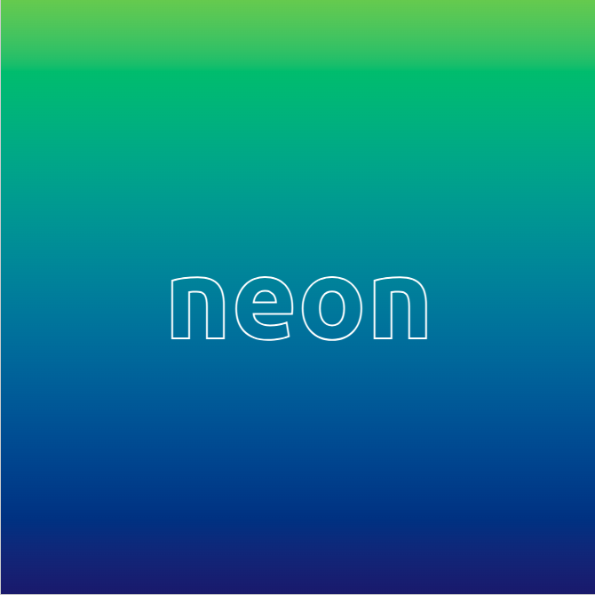  

  
Gebruikte lettertype(n)
  
 
  * x

  
Gebruikte kleur(en)

 
  * x

  
Je het de volgende CSS nodig

   
  * x

  

  
<h3>tips Hello</h3>

    

  
Gebruikte lettertype(n)
  
 
  * x

  
Gebruikte kleur(en)

 
  * x

  
Je het de volgende CSS nodig

   
  * x

  

  
<h3>tips CMYK</h3>

  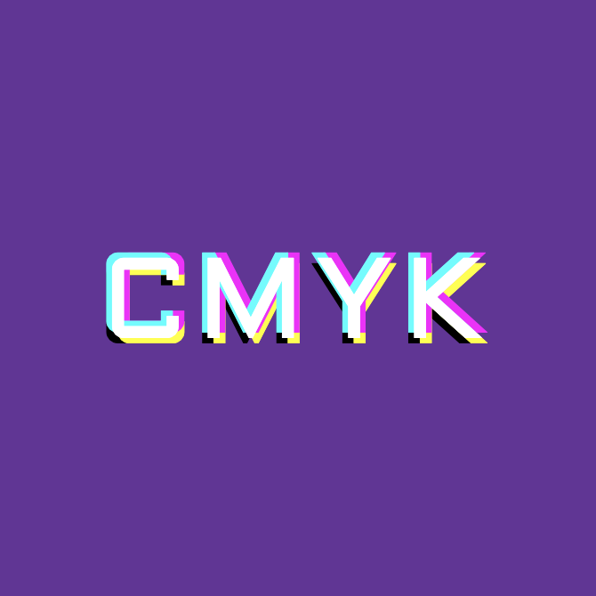  

  
Gebruikte lettertype(n)
  
 
  * x

  
Gebruikte kleur(en)

 
  * x

  
Je het de volgende CSS nodig

   
  * x

  

  
<h3>tips Cold</h3>

  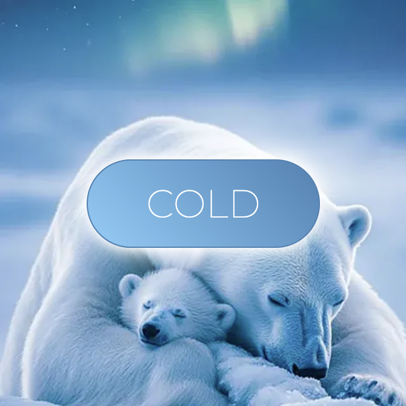  

  
Gebruikte lettertype(n)
  
 
  * x

  
Gebruikte kleur(en)

 
  * x

  
Je het de volgende CSS nodig

   
  * x

  

  
<h3>tips Blauw vs Rood</h3>

  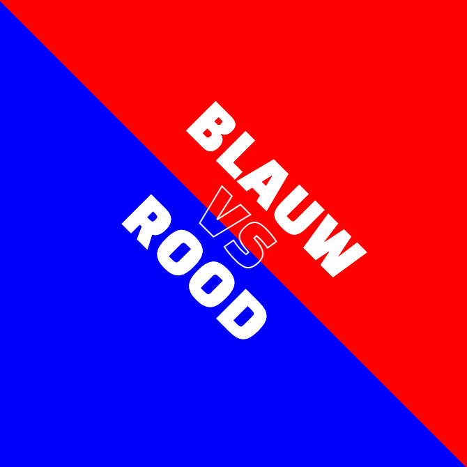  

  
Gebruikte lettertype(n)
  
 
  * x

  
Gebruikte kleur(en)

 
  * x

  
Je het de volgende CSS nodig

   
  * x

  

  
<h3>tips Ticket</h3>

    

  
Gebruikte lettertype(n)
  
 
  * x

  
Gebruikte kleur(en)

 
  * x

  
Je het de volgende CSS nodig

   
  * x

  

  
<h3>tips Puff</h3>

  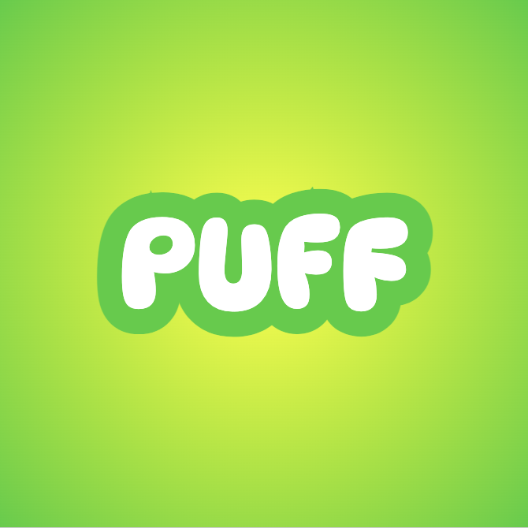  

  
Gebruikte lettertype(n)
  
 
  * x

  
Gebruikte kleur(en)

 
  * x

  
Je het de volgende CSS nodig

   
  * x

  

  
<h3>tips Verzonken</h3>

    

  
Gebruikte lettertype(n)
  
 
  * x

  
Gebruikte kleur(en)

 
  * x

  
Je het de volgende CSS nodig

   
  * x

  

  
<h3>tips A2</h3>

  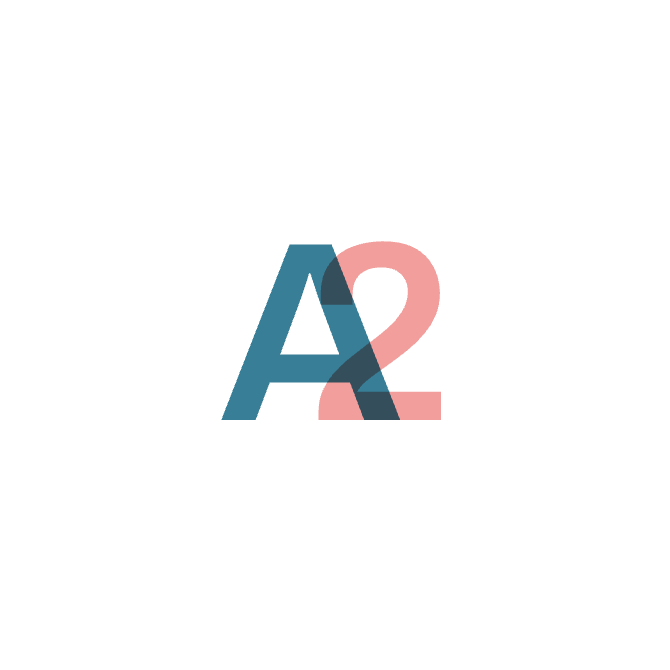  

  
Gebruikte lettertype(n)
  
 
  * x

  
Gebruikte kleur(en)

 
  * x

  
Je het de volgende CSS nodig

   
  * x

  

  
<h3>tips But First Coffee</h3>

  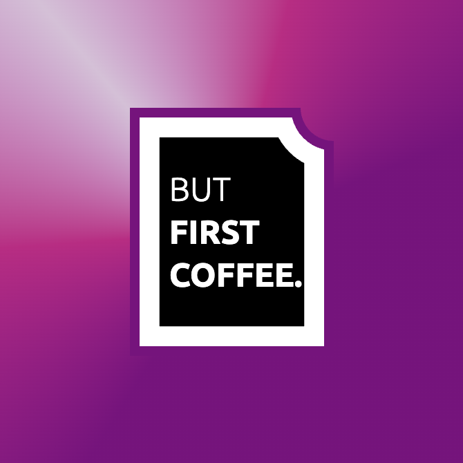  

  
Gebruikte lettertype(n)
  
 
  * x

  
Gebruikte kleur(en)

 
  * x

  
Je het de volgende CSS nodig

   
  * x

  

  
<h3>tips Bananas</h3>

  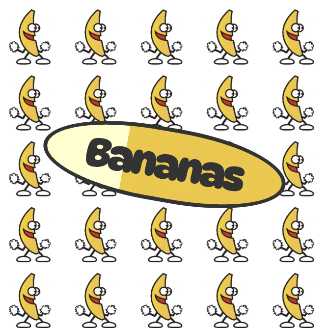  

  
Gebruikte lettertype(n)
  
 
  * x

  
Gebruikte kleur(en)

 
  * x

  
Je het de volgende CSS nodig

   
  * x

  

  
<h3>tips Chess</h3>

  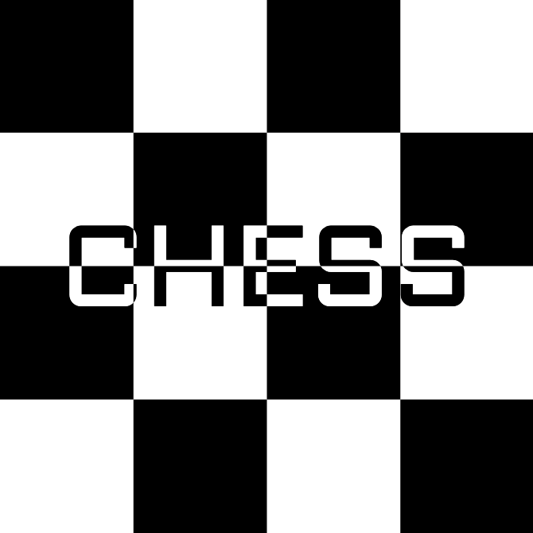  

  
Gebruikte lettertype(n)
  
 
  * x

  
Gebruikte kleur(en)

 
  * x

  
Je het de volgende CSS nodig

   
  * x

  

  
<h3>tips Nemo</h3>

  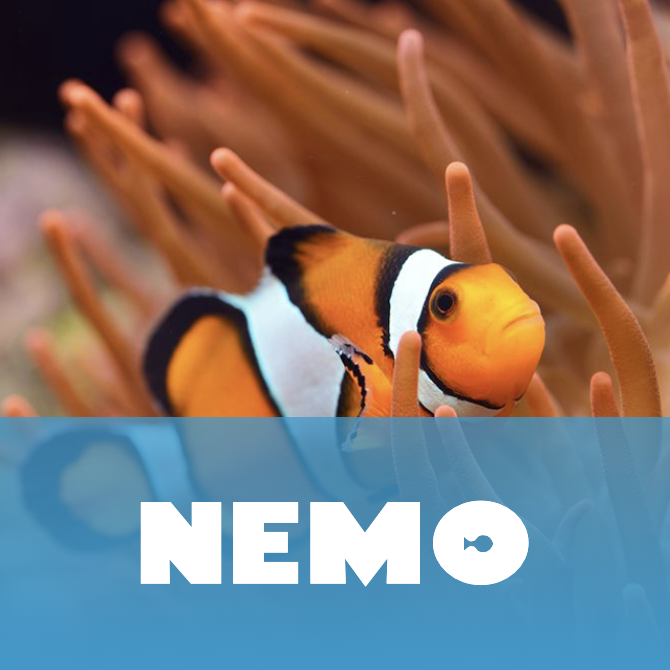  

  
Gebruikte lettertype(n)
  
 
  * x

  
Gebruikte kleur(en)

 
  * x

  
Je het de volgende CSS nodig

   
  * x

  

  
<h3>tips Wazig</h3>

  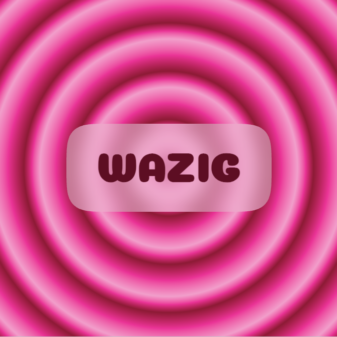  

  
Gebruikte lettertype(n)
  
 
  * x

  
Gebruikte kleur(en)

 
  * x

  
Je het de volgende CSS nodig

   
  * x

  

  
<h3>tips Brillo</h3>

    

  
Gebruikte lettertype(n)
  
 
  * x

  
Gebruikte kleur(en)

 
  * x

  
Je het de volgende CSS nodig

   
  * x

  

  
<h3>tips AU</h3>

  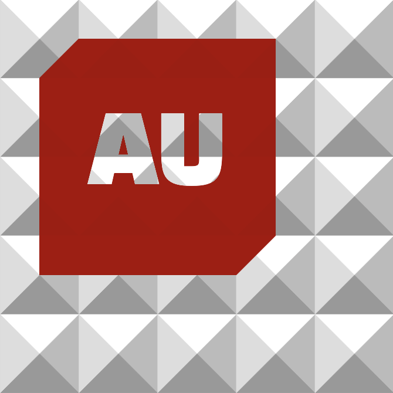  

  
Gebruikte lettertype(n)
  
 
  * x

  
Gebruikte kleur(en)

 
  * x

  
Je het de volgende CSS nodig

   
  * x

  

  
<h3>tips Messi</h3>

  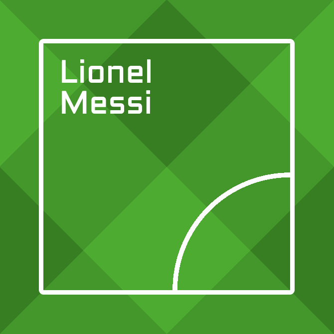  

  
Gebruikte lettertype(n)
  
 
  * x

  
Gebruikte kleur(en)

 
  * x

  
Je het de volgende CSS nodig

   
  * x

  

---
 
## Links

🎯 ⸺ [web-safe fonts](https://web.mit.edu/jmorzins/www/fonts.html) (www 🧑‍💻)   

🎯 ⸺ [@font-face intro](https://www.w3schools.com/CSSref/atrule_font-face.php) (w3schools 🐥)     
🎯 ⸺ [@font-face uitgebreider](https://hacks.mozilla.org/2009/06/beautiful-fonts-with-font-face/) (MDN 🦊)    

🎯 ⸺ [font-weight](https://developer.mozilla.org/en-US/docs/Web/CSS/@font-face/font-weight) (MDN 🦊)    
🎯 ⸺ [font-style](https://developer.mozilla.org/en-US/docs/Web/CSS/@font-face/font-style) (MDN 🦊)    
🎯 ⸺ [font-strectch](https://developer.mozilla.org/en-US/docs/Web/CSS/@font-face/font-stretch) (MDN 🦊)    
🎯 ⸺ [font-display](https://developer.mozilla.org/en-US/docs/Web/CSS/@font-face/font-display) (MDN 🦊)    
🎯 ⸺ [font-variation-settings](https://developer.mozilla.org/en-US/docs/Web/CSS/@font-face/font-variation-settings) (MDN 🦊)    

🎯 ⸺ [variabele fonts intro](https://developer.mozilla.org/en-US/docs/Web/CSS/CSS_fonts/Variable_fonts_guide) (MDN 🦊)  
🎯 ⸺ [variabele fonts collectie](https://fonts.google.com/?categoryFilters=Technology:%2FTechnology%2FVariable) (Google fonts🦖)  
🎯 ⸺ [variabele fonts voorbeelden](https://speckyboy.com/variable-font-examples/) (www 🧑‍💻)  

🎯 ⸺ [wakamaifondue - de font info tool](https://wakamaifondue.com/beta/) (roel niekskens 🤴)  
🎯 ⸺ [Font Squirrel - font generator](https://www.fontsquirrel.com/tools/webfont-generator) (www 🐿️)  

🎯 ⸺ [FOIT vs FOUT](https://www.hoppinger.com/nl/insights/loading-webfonts#:~:text=Maar%20hoe%20voorziet%20een%20browser,of%20Unstyled%20Text%20(FOUT).) (www 🧑‍💻)  
🎯 ⸺ [Google fonts illegaal in EU](https://slik.nl/blog/google-fonts/) (www 🧑‍💻)   